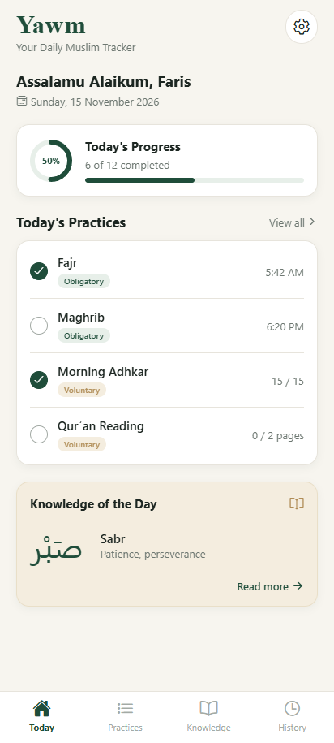
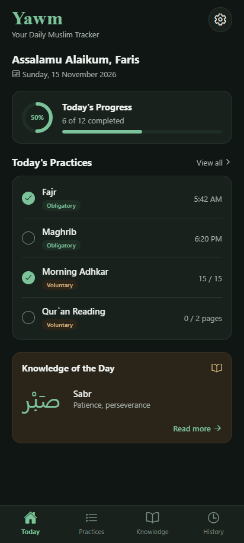

# Yawm (يوم) — Daily Muslim Tracker

Yawm helps Muslims organise their daily worship and Islamic learning. Users track
obligatory and voluntary acts of worship (the five daily prayers, Sunnah prayers,
morning and evening adhkar, Qurʾan reading) and receive a Hadith and an Arabic
word every day.

Built with **React Native + Expo (SDK 58) + TypeScript** as a semester project for
the Cross-Platform Development course.

## Screens

| Screen | Purpose |
| --- | --- |
| Today | Greeting, date, daily progress, today's practices, knowledge of the day |
| Practices | All practices grouped into obligatory prayers, Sunnah prayers and daily worship, with filters and sorting |
| Practice Details | Description, progress, completion status, date and notes |
| Knowledge | Hadith of the Day (Arabic, translation, source, grade) and Arabic Word of the Day |
| Add / Edit Practice | Form for creating and customising a practice |
| History | Weekly overview and previous days |
| Settings & Routine | Daily routine toggles, reminders and account |

## Features

- [x] Expo TypeScript project that runs in Expo Go
- [x] Static versions of all seven screens with sample data
- [x] StyleSheet theme with light and dark mode, responsive layout and safe areas
- [x] Practice list with `SectionList`, filters, sorting, empty, loading and error states
- [ ] Expo Router navigation with a dynamic practice detail route
- [ ] Tabs and an Add / Edit Practice modal
- [ ] Create and edit forms with validation
- [ ] Global state for practices and settings
- [ ] Local persistence on the device
- [ ] Device feature (daily reminder notifications / haptics)
- [ ] Supabase email/password login and cloud data
- [ ] Android APK built with EAS

## Getting started

Requirements: Node.js 20+ and the **Expo Go** app on your phone.

```bash
git clone <repository-url>
cd yawm
npm install
npx expo start
```

Scan the QR code shown in the terminal with Expo Go (Android) or the Camera app (iOS).
The phone and computer must be on the same Wi-Fi network; otherwise run
`npx expo start --tunnel`.

## Project structure

```
App.tsx              Root component; switches between screens (temporary, until Expo Router)
src/
  components/        Reusable UI: Card, Badge, Button, Checkbox, ProgressBar/Ring, tab bar…
  screens/           One file per screen
  data/mockData.ts   Static sample practices, hadith, Arabic word and history
  data/api.ts        Fake API: returns the sample practices after a short delay (until Supabase)
  constants/theme.ts Light and dark colours, spacing, radius and font sizes
  hooks/use-theme.ts Picks the light or dark colours from the phone's setting
  types/             Shared TypeScript types (Practice, Hadith, ArabicWord…)
  utils/             Date formatting and practice helpers
```

## Progress log

- **Week 4** — Project created with `create-expo-app` (blank TypeScript template).
  Added the theme, data types, sample data, reusable components and static
  versions of all seven screens, connected with a temporary bottom tab bar.
- **Week 5** (finished in Week 6) — Light and dark theme with a `useTheme` hook, used by
  every component and screen; summary row on the Practices screen; content limited to
  600 dp and centred on wide screens; ESLint and web support for checking layouts.
- **Week 6** — Practices screen rebuilt as a `SectionList` with the summary row and the
  filter and sort chips as its header. The practices come from a fake API with loading,
  error (Try again) and empty states and pull-to-refresh; a long press deletes a practice
  after a confirmation, and rows and chips are described for screen readers.

## Screenshots

| Light mode | Dark mode |
| --- | --- |
|  |  |

## Content sources

The Hadith of the Day is taken from *Sahih Muslim* (no. 2699). Hadith text, source and
grade are shown only where they are reliably established.
